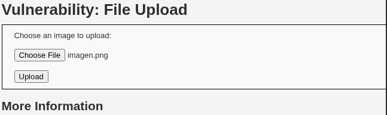
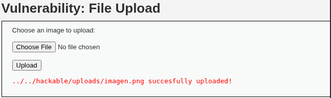

# Reporte del Taller 3

Versión de lectura en GitHub. El PDF conserva la distribución original de dos páginas.

```text
Taller 3: Unrestricted File Upload
 Observación y análisis de controles de carga en DVWA — nivel Medium

 Objetivo y entorno
 Observar cómo DVWA procesa archivos permitidos y bloqueados, identificar los datos enviados por el cliente y
 comparar las respuestas del servidor mediante Burp Suite. La práctica se realizó en un laboratorio local autorizado,
 con Kali Linux, DVWA en localhost/DVWA y Burp Suite Community Edition v2026.3.2. Las respuestas identifican
 Apache/2.4.68 (Debian), el usuario de laboratorio admin, nivel Medium y backend SQLi mysql; no se verificó por
 separado la versión del motor de base de datos.

 Procedimiento y resultados
 En Vulnerabilities → File Upload se probaron un archivo de texto benigno, una imagen PNG y un archivo con
 extensión PHP que contenía solamente texto, sin código ejecutable. Se observaron los POST y sus respuestas en
 Burp. El formulario emplea multipart/form-data y el parámetro uploaded; filename indica el nombre enviado y el
 Content-Type de esa parte declara el tipo del archivo.

        Archivo / MIME declarado                                  HTTP       Content-Length¹          Resultado

        prueba.txt / text/plain                                   200        4601 bytes               Rechazado

        imagen.png / image/png                                    200        4589 bytes               Aceptado

        comparacion.php / application/x-php                       200        4601 bytes               Rechazado

        imagen3.png / image/png²                                  200        4590 bytes               Aceptado
 ¹ Tamaño declarado del cuerpo de la respuesta HTML, no del archivo subido ni de la respuesta HTTP completa. ² Prueba de modificación del
 nombre mediante Repeater.

 La imagen fue aceptada con el mensaje ../../hackable/uploads/imagen.png succesfully uploaded!. TXT y PHP
 fueron rechazados con Your image was not uploaded. We can only accept JPEG or PNG images.. Los
 rechazos también devolvieron HTTP 200: el resultado de la carga se determina por el mensaje de la aplicación, no
 solamente por el estado HTTP.

 Modificación controlada en Repeater
 Se envió a Repeater una solicitud de imagen2.png y se cambió únicamente filename a imagen3.png, conservando
 el tipo image/png y el contenido de la imagen. Tras Send, la respuesta confirmó
 ../../hackable/uploads/imagen3.png succesfully uploaded!. Las capturas de Repeater aportadas muestran el
 nombre original, la modificación y la respuesta. Esto demuestra que la aplicación conserva el nombre elegido por el
 cliente en el caso probado; no demuestra evasión del filtro ni ejecución de código.


Taller 3 · DVWA Medium · Laboratorio local autorizado                                                                                       1

 Evidencia de la carga permitida


 Figura 1. Recortes de las capturas originales: selección de imagen.png (izquierda) y mensaje de carga aceptada (derecha). Se recortó
 únicamente para legibilidad.

 Evidencia HTTP y comparación
 Los archivos HTTP-POST-txt y HTTP-POST-comparacion incluyen el mensaje de rechazo; HTTP-POST-imagen
 confirma la ruta de carga. Las respuestas HTML identifican el nivel Medium. Las capturas de Burp aportadas
 permiten identificar uploaded, filename y los tipos text/plain, application/x-php e image/png. La respuesta adicional
 de Repeater confirma imagen3.png y Content-Length: 4590.

 Los cuerpos de las respuestas de rechazo tienen la misma longitud declarada (4601 bytes), mientras que la
 aceptación de imagen.png tiene 4589 bytes. La aceptación de imagen3.png tiene 4590 bytes, coherente con un
 carácter adicional en el nombre mostrado. La longitud complementa el análisis; por sí sola no determina si la carga
 fue aceptada.

 Análisis de los controles y sus limitaciones
 Se observó un comportamiento selectivo: PNG aceptado y TXT/PHP rechazados. Sin embargo, extensión y MIME
 cambiaron simultáneamente entre esas pruebas; por ello no se puede concluir experimentalmente cuál de los dos
 determina el rechazo, ni afirmar que se verificó el contenido real. No se aportó el código de View Source para
 confirmar la implementación del filtro. El campo MAX_FILE_SIZE=100000 aparece en la solicitud, pero no se probó
 un archivo que superara el límite; su presencia no demuestra un control robusto de tamaño en el servidor.

 El nombre enviado se conserva en la ruta de aceptación y la respuesta revela la ubicación relativa
 hackable/uploads. Esto aporta información sobre el almacenamiento, aunque no demuestra ejecución de scripts,
 sobrescritura de archivos o acceso posterior al archivo. El bloqueo observado reduce la entrada de tipos no
 previstos en estas pruebas, pero no permite calificar el mecanismo como completamente seguro.

 Riesgo, mitigación y reflexión
 La carga sin validación suficiente se relaciona con CWE-434. Dependiendo del almacenamiento y procesamiento,
 puede afectar confidencialidad, integridad y disponibilidad. Estos son riesgos potenciales: la práctica no demostró
 lectura de datos sensibles, ejecución de código ni afectación del servicio. La puntuación CVSS 9.8 del material es
 una referencia de impacto potencial, no una severidad medida para estas pruebas.

 Se recomienda validar en el servidor una lista de tipos y extensiones permitidos, verificar contenido real, aplicar
 límites de tamaño, generar nombres únicos y almacenar fuera del web root o impedir la ejecución de scripts en el
 directorio de carga. Medium permite observar controles básicos, pero aceptar una imagen y rechazar dos tipos no
 garantiza seguridad integral. El aprendizaje principal fue distinguir metadatos declarados por el cliente, respuesta
 HTTP y resultado funcional, y documentar tanto los hallazgos como lo que no se comprobó.
 Referencias: Taller 3 - UFU.pdf, pp. 2–9; evidencias y respuestas HTTP de la práctica aportadas por el estudiante; OWASP, File Upload Cheat
 Sheet (cheatsheetseries.owasp.org); CWE-434 (cwe.mitre.org/data/definitions/434.html).


Taller 3 · DVWA Medium · Laboratorio local autorizado                                                                                          2
```

## Capturas de evidencia

Selección del archivo PNG:



Carga aceptada:


